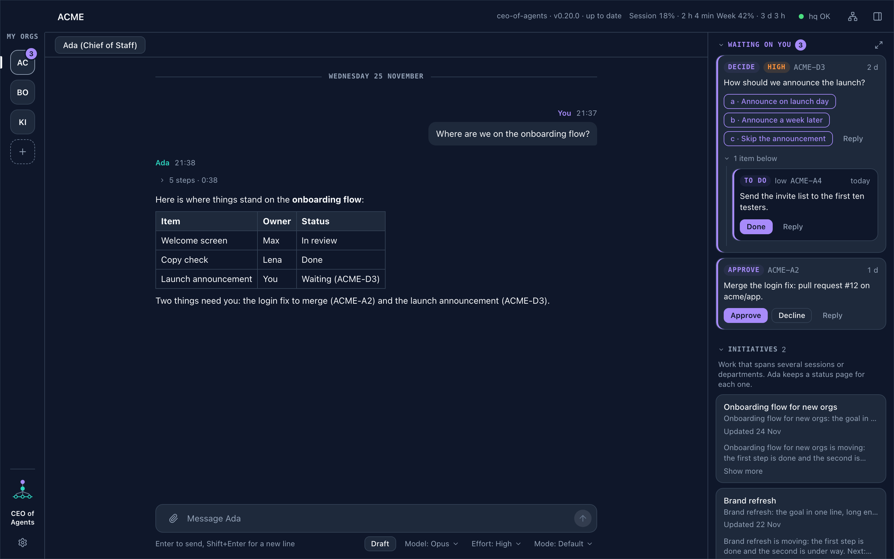
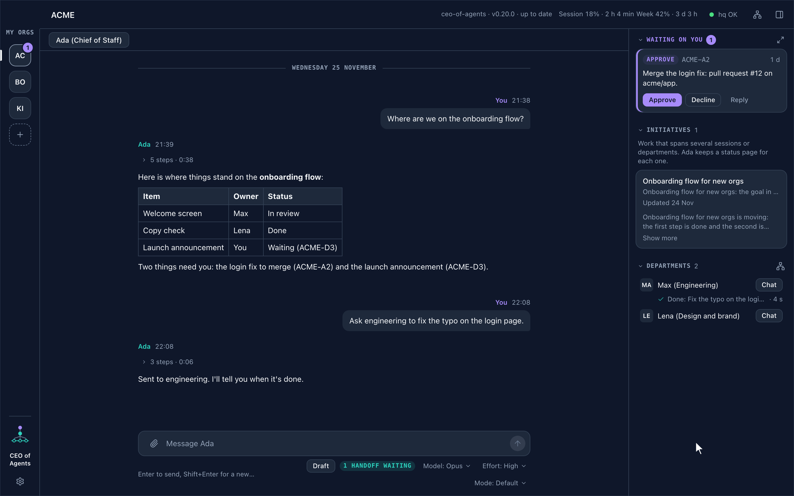
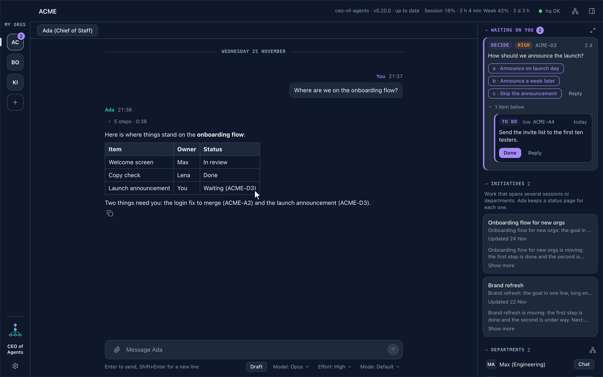
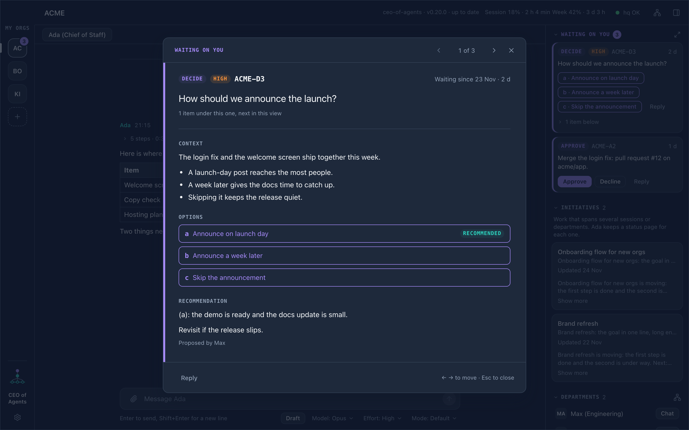
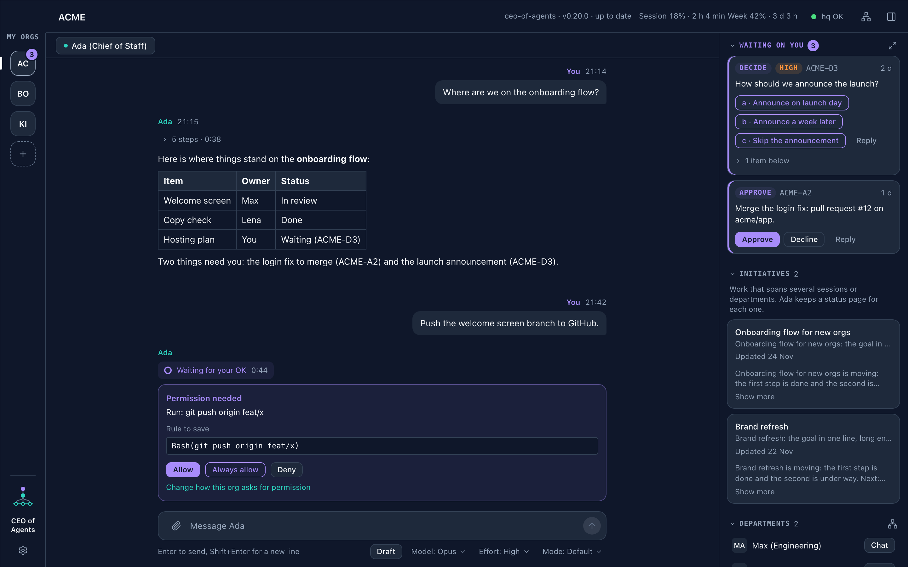
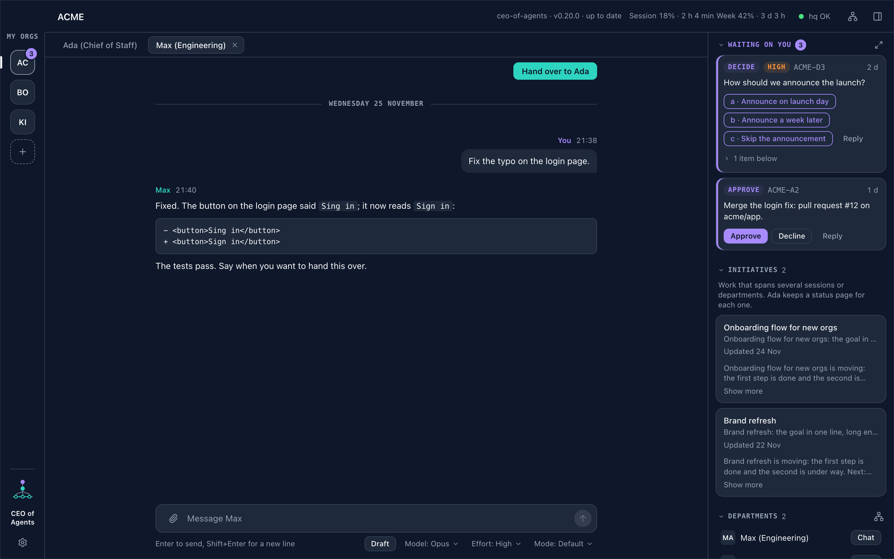
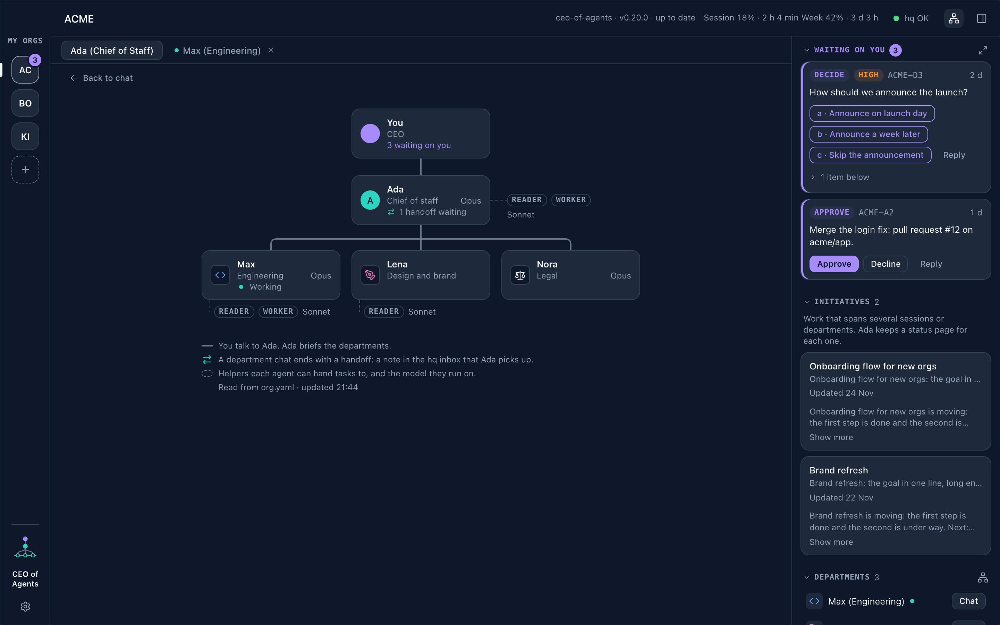

<p align="center">
  
</p>
<h1 align="center">CEO of Agents for Mac</h1>

<p align="center">
  <b>The desktop app for ceo-of-agents: talk to your chief of staff, approve what waits on you and watch your departments work.<br>One window, on your own Claude Code.</b>
</p>

<p align="center">
  <a href="https://github.com/ceo-of-agents/ceo-of-agents-desktop/releases/latest"></a>
</p>
<p align="center">
  <sub>macOS 13+ (Apple silicon) · Claude Code 2.1.326 or later · free and open source (MIT)</sub>
</p>

<p align="center">
  
</p>

## What it does

[ceo-of-agents](https://github.com/ceo-of-agents/ceo-of-agents-core) is a Claude Code plugin that runs your work like a small company: you are the CEO, a chief of staff routes the work, departments do it, and every decision is written down in a git repo you own, the hq. This app gives that company a window.

- **[One thread with your chief of staff](#one-thread-with-your-chief-of-staff)**: one conversation that keeps going across days; your chief of staff answers or sends the work to a department.
- **[Waiting on you](#waiting-on-you)**: every approval and decision in one list. Approve, decline or pick an option in one click, with undo.
- **[Approve before anything runs](#approve-before-anything-runs)**: Claude Code's own permission prompts show up as cards.
- **[Department chats](#department-chats)**: talk to a department directly; chats run side by side and end with a handoff.
- **[A live org chart](#a-live-org-chart)**: your departments, their models and who is working right now.

Nothing important happens without your OK: your org's approval rules still apply, and the top bar shows at a glance whether your hq is in sync.

## Install

1. **[Download CEO of Agents](https://github.com/ceo-of-agents/ceo-of-agents-desktop/releases/latest)** (`CEO-of-Agents-<version>.dmg`).
2. Open the `.dmg` and drag **CEO of Agents** into Applications. The first time you open it, macOS blocks it because the app isn't notarized by Apple yet: click **Done**, then go to **System Settings › Privacy & Security**, scroll to Security and click **Open Anyway** next to "CEO of Agents". From then on it opens normally.
   Prefer the Terminal? A copy downloaded with the GitHub CLI opens without this step:
   ```sh
   gh release download -R ceo-of-agents/ceo-of-agents-desktop -p '*.dmg'
   ```
   Or, after copying the app to Applications:
   ```sh
   xattr -dr com.apple.quarantine "/Applications/CEO of Agents.app"
   ```
3. Sign in to Claude Code (`claude`, then `/login`) if you haven't.
4. Open your hq folder, or create a new org from the app.

**Updates.** When a new version is out, an **Update app** button appears in the top bar (it uses the GitHub CLI, `gh`, signed in). You can also download the new `.dmg` from the latest release.

---

## One thread with your chief of staff

<p align="center">
  <picture>
    <source media="(min-width: 700px)" srcset="docs/media/dispatch.gif">
    
  </picture>
</p>
<p align="center"><sub><b>Ask, and it routes</b>: your chief of staff sends the work to engineering and tells you when the handoff is in.</sub></p>

Talk in plain language. Each message goes to your own Claude Code, running in your hq folder. Your chief of staff answers, or sends the work to a department and tells you when it is done. The thread keeps going across days; a fresh Claude Code session starts behind it when it needs to.

| You type | What happens |
|---|---|
| `What's waiting on me?` | Your chief of staff lists what needs your OK, with its codes. |
| `Ask engineering to fix the typo on the login page.` | The work goes to the engineering department; you see it running, then its handoff. |
| `Approve ACME-A2.` | Your chief of staff carries out exactly that and records it in the hq. |
| `Brief.` | A dated brief of what changed, saved in the hq. |

## Waiting on you

<p align="center">
  <picture>
    <source media="(min-width: 700px)" srcset="docs/media/approve.gif">
    
  </picture>
</p>
<p align="center"><sub><b>One click, with undo</b>: approve, and you have four seconds to change your mind.</sub></p>

Everything that needs you sits in one list, read from your hq: approvals, decisions and their options. Approve, decline, pick an option or reply; your chief of staff carries it out and records it. To go through a long list, the focus view shows one item at a time.

<p align="center">
  
</p>
<p align="center"><sub><b>Focus view</b> (⌘⇧F): one item at a time, with its options and the recommended one.</sub></p>

## Approve before anything runs

<p align="center">
  
</p>
<p align="center"><sub><b>Permission cards</b>: allow once, always allow a narrow rule, or deny.</sub></p>

When Claude Code asks for permission, the app shows its prompt as a card in the conversation. Your Claude Code permission rules and your org's approval rules stay in charge.

## Department chats

<p align="center">
  
</p>
<p align="center"><sub><b>Hand over</b>: when you are done, the result goes to your chief of staff.</sub></p>

Open a chat with one department for longer work. Chats with different departments run side by side. When you are done, **Hand over** passes the result to your chief of staff, so nothing gets lost.

## A live org chart

<p align="center">
  
</p>
<p align="center"><sub><b>Org chart</b> (⌘⇧O): who reports to whom, which model each one uses, who is working and where a handoff waits.</sub></p>

## Requirements

- A Mac with Apple silicon, macOS 13 (Ventura) or later. This minimum comes from the Electron version the app is built on (Electron 44 and later need macOS 13); older versions are not tested.
- Claude Code, installed and signed in with your own account, version 2.1.326 or later. The app checks the version at launch and tells you if yours is outside the supported range.
- git (Apple's command line tools: `xcode-select --install`).
- An hq set up with the [ceo-of-agents plugin](https://github.com/ceo-of-agents/ceo-of-agents-core), or create a new org from the app.
- Optional: the GitHub CLI (`gh`), signed in, for in-app updates.

## Your account and your data

- **Your Claude Code, your sign-in.** The app drives the Claude Code you already use. It never asks for a password or an API key, never reads your credentials and never calls the Claude API itself. Your plan, your limits and your permission rules stay as they are.
- **Local.** Chats and settings stay on your Mac. The app changes your hq only through your chats and, if you turn it on, an automatic push of the hq.
- **Independent.** CEO of Agents is an independent open-source project. It is not made by, affiliated with or endorsed by Anthropic. Claude Code is a product of Anthropic.

## Part of ceo-of-agents

The app is a window on the [ceo-of-agents plugin](https://github.com/ceo-of-agents/ceo-of-agents-core) for Claude Code, which sets up your org, its approval rules and its hq. What the plugin does, in short:

https://github.com/user-attachments/assets/4908a78b-c24e-4bcd-ab51-a64db12b38a9

## Build from source

Needs Node.js 20 or later.

```sh
npm install
npm start
```

To build a local app and disk image (unsigned): `npm run package:mac`, output in `out/`.

See [CLAUDE.md](CLAUDE.md) for the architecture and [CONTRIBUTING.md](CONTRIBUTING.md) for how to contribute.

## License

MIT. See [LICENSE](LICENSE).
